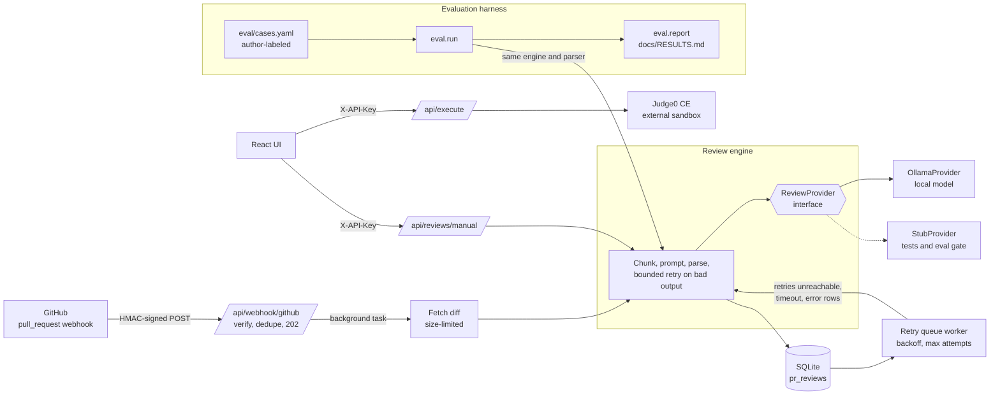

# CodeRev Bot

A self-hosted pull request reviewer that uses a small local LLM (Ollama) to flag bugs and security issues, with a sandboxed Run Code button and an evaluation harness that measures how good the reviews are.

[](https://github.com/mayankranjan-dev/coderev/actions/workflows/ci.yml)
[](LICENSE)
[](.github/workflows/ci.yml)

## Hero claim

An evaluation harness for measuring this reviewer on real historical bugs is built; results will be published here. No recall or false-positive numbers have been measured yet (`docs/RESULTS.md`: TBD (not yet measured)).

## Why this exists

Small local models are cheap and keep code on your machine, but nobody knows how many real bugs they catch or how often they cry wolf. This project builds the reviewer and, separately, the measurement setup to answer that question with labeled bug-fix commits and control commits instead of impressions. Until that measurement is done, treat the reviewer's findings as suggestions to check, not as verdicts.

## Architecture



Details: [docs/ARCHITECTURE.md](docs/ARCHITECTURE.md).

## Quick start

Commands and how far each was checked are listed in [docs/DEPLOY.md](docs/DEPLOY.md). Set `WEBHOOK_SECRET` and `CODEREV_API_KEY` first (names only in `.env.example`).

### Docker (verified by the owner on 2026-10-31)

```powershell
$env:CODEREV_API_KEY = "<your API key>"
$env:WEBHOOK_SECRET = "<your webhook secret>"
docker compose up --build -d
curl http://127.0.0.1:8000/api/health
```

Expected output with Ollama not reachable from the container: `{"status":"ok","ollama_reachable":false}`. The port is bound to loopback. To use Ollama on the host, see "Verified Docker run" in [docs/DEPLOY.md](docs/DEPLOY.md).

### Local

```powershell
python -m venv .venv
.\.venv\Scripts\python.exe -m pip install -r requirements.txt
copy .env.example .env     # then edit .env
ollama pull qwen2.5-coder:1.5b
cd frontend; npm ci; npm run build; cd ..
.\.venv\Scripts\python.exe -m uvicorn main:app --host 127.0.0.1 --port 8000
```

Then open `http://127.0.0.1:8000` and enter your API key in the UI (kept in `sessionStorage`, never bundled). `npm run build` was run and passes. The `uvicorn` command as a live server and `ollama pull` have not been run by the assistant; see DEPLOY.md.

### Tests

```powershell
.\.venv\Scripts\python.exe -m pip install -r requirements-dev.txt
.\.venv\Scripts\python.exe -m pytest -q
```

CI runs lint, tests on Python 3.11 and 3.12, the frontend build, and a synthetic eval regression gate. The gate checks the harness with a stub provider, not model quality.

> Screenshot to add: `docs/img/landing.png` (landing page), `docs/img/manual-review.png` (structured findings), `docs/img/run-code-terminal.png` (Run Code terminal). Capture list: [docs/img/README.md](docs/img/README.md).

## Evaluation status

Results: TBD (not yet measured). See [docs/RESULTS.md](docs/RESULTS.md). The full method is in [docs/EVAL_DESIGN.md](docs/EVAL_DESIGN.md).

Method, as built:

- **Cases:** real bug-fix commits, each labeled by the author with the buggy file and line range, plus control commits that are ordinary changes.
- **Input:** for a bug case the reviewer sees the reverse of the fix (a change that introduces the bug). For a control case it sees the forward diff.
- **Catch:** a finding counts when the matching function `is_catch` says it hits the labeled file and lines within a tolerance. Recall is reported at several tolerances.
- **False positives:** controls that receive at least one CRITICAL finding.
- **Repeats:** each configuration runs 3 times with fixed seeds, with bootstrap intervals over cases.
- **Ablations:** model size, prompt variant, chunking, and retry, one factor at a time.

Pending (owner work, see [docs/eval/AUTHOR_TODO.md](docs/eval/AUTHOR_TODO.md)): label the cases, write the `is_catch` body, run the pilot, baseline and ablations, then publish with `python -m eval.report --write-results`. The matcher is author-owned and currently raises `NotImplementedError`, so no recall figure can be produced yet.

## Security

Protected:

- **API key** (`X-API-Key`) on `/api/reviews`, `/api/reviews/manual` and `/api/execute`. An unset key fails closed.
- **Webhook HMAC-SHA256** over the raw body, constant-time compare, fails closed without a secret. Redeliveries for the same head commit are deduplicated.
- **Rate limits** per client IP on manual review and code execution (configurable).
- **Size limits** on manual submissions, execute snippets and fetched PR diffs (configurable).
- **CORS** allow-list; a wildcard origin is ignored.
- User code never runs on the host; it goes to Judge0.
- The container runs as a non-root user and publishes its port on loopback only.

Not protected:

- No user accounts. One shared API key; anyone holding it has full access.
- The sandbox is the **public Judge0 CE instance**: shared, rate-limited, no SLA. Code you run there leaves your machine.
- The sandbox runs **Python 3.8**, so newer syntax fails there.
- Rate limits are in memory and per process; `X-Forwarded-For` is not trusted.
- Ollama has no authentication. Do not expose its port.

Frontend dependency audit: `npm audit` reports 0 vulnerabilities after the vite bump (command: `npm audit` in `frontend/`). Notes: [docs/SECURITY_NOTES.md](docs/SECURITY_NOTES.md).

## Limitations

- **Small model:** the default is a 1.5B-parameter local model (`qwen2.5-coder:1.5b`). Expect missed bugs and invented ones.
- **Small sample:** the planned dataset is small, so intervals will be wide (see EVAL_DESIGN section 6.3).
- **Label subjectivity:** one author picks the lines and categories.
- **Contamination risk:** the model may have seen the fix commits in training. Cases before a cutoff date are reported separately.
- **Reverse-diff setup:** a reversed fix is small and centered on the bug, which likely makes recall look better than on real pull requests.
- **Judge0 runs Python 3.8** and is a shared public instance.
- **Ephemeral SQLite on free hosts:** a restart wipes reviews and the retry queue. Use a persistent volume (see DEPLOY.md).
- **Severity labels are inconsistent across runs** for the same issue. Treat the severity as a rough hint.
- **No comments are posted back to GitHub.** Results appear only in this app.

## What I'd do next

1. Label the cases and implement `is_catch`, then publish the first measured baseline.
2. Run the ablations (model size, prompt, chunking, retry) and report which factors matter.
3. Compare against a larger model on the same cases to see how much of the gap is model size.
4. Post review comments back to the pull request.
5. Move to a hosted database and per-user authentication if it is ever deployed beyond one owner.

## More

[Architecture](docs/ARCHITECTURE.md) · [Deployment](docs/DEPLOY.md) · [Eval design](docs/EVAL_DESIGN.md) · [Decisions](docs/DECISIONS.md) · [Audit](docs/AUDIT.md) · [Contributing](CONTRIBUTING.md) · [License](LICENSE)

Git hooks: fresh clones must run `powershell -File scripts/setup-hooks.ps1` once to enable the pre-push guard.
