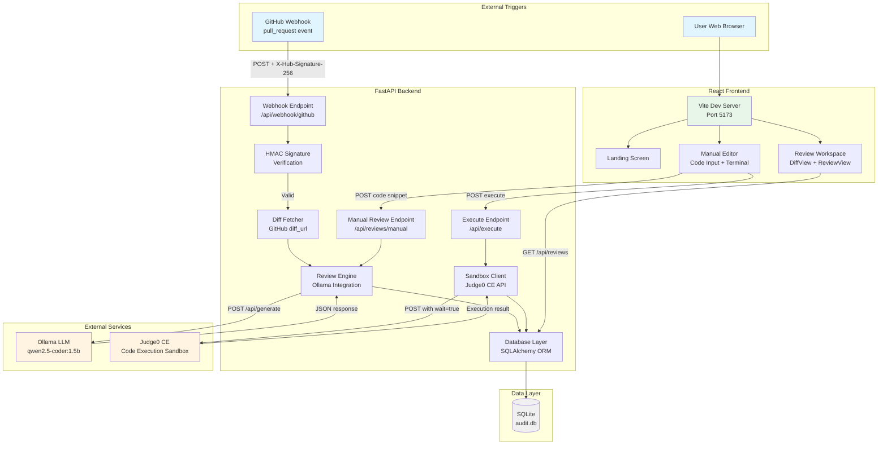

<div align="center">

# 🤖 CodeRev Bot

### Automated Code Review with AI-Powered Analysis and Sandbox Execution

[](https://www.python.org/)
[](https://fastapi.tiangolo.com/)
[](https://reactjs.org/)
[](https://vitejs.dev/)
[](https://tailwindcss.com/)
[](https://www.sqlite.org/)

[Live Demo](#) • [Documentation](#) • [Report Bug](https://github.com/mayankranjan-dev/coderev/issues) • [Request Feature](https://github.com/mayankranjan-dev/coderev/issues)

</div>

---

## 📋 Table of Contents

- [Overview](#-overview)
- [Project Demo](#-project-demo)
- [Key Features](#-key-features)
- [System Architecture](#-system-architecture)
- [Technology Stack](#-technology-stack)
- [Project Structure](#-project-structure)
- [Installation & Setup](#-installation--setup)
- [Environment Configuration](#-environment-configuration)
- [API Documentation](#-api-documentation)
- [Usage](#-usage)
- [Troubleshooting](#-troubleshooting)
- [Known Limitations](#-known-limitations)
- [License](#-license)

---

## 🎯 Overview

**CodeRev Bot** is an intelligent, automated code review system that combines AI-powered static analysis with secure sandbox execution. The project addresses the challenge of maintaining code quality and security across pull requests by providing instant, AI-driven feedback on vulnerabilities, bugs, and code smells.

### Problem Statement

Modern development teams face:
- Manual code reviews that are time-consuming and inconsistent
- Security vulnerabilities that slip through human review
- Lack of immediate feedback on pull requests
- No safe environment to test code snippets before deployment

### Solution

CodeRev Bot provides a three-mode operational system:

1. **GitHub Webhook Mode** — Automatically reviews PRs when opened or updated
2. **Manual Review Mode** — Submit code snippets directly through a web UI
3. **Sandbox Execution Mode** — Run Python code securely in an isolated environment

The system uses a locally-running Ollama LLM (qwen2.5-coder:1.5b) for intelligent code analysis and Judge0 Community Edition for secure code execution, ensuring both fast performance and safety.

---

## 🎬 Project Demo

<!-- PROJECT DEMO GIF: Replace the path below with your actual demo GIF -->
<p align="center">
  
</p>

<p align="center">
  <em>End-to-end demonstration of webhook review, manual code analysis, and sandbox execution.</em>
</p>

<!-- 
To add your demo GIF:
1. Create an 'assets' folder in the project root
2. Record a GIF showing the workflow (webhook trigger, manual review, code execution)
3. Save it as 'assets/project-demo.gif'
4. Or replace the path above with a hosted URL (e.g., from Imgur or GitHub releases)
-->

---

## ✨ Key Features

### 🔍 Intelligent Code Analysis
- **Severity-Tagged Findings**: Automatically categorizes issues as CRITICAL, WARNING, or NITPICK
- **Security-First**: Detects SQL injection, command injection, hardcoded secrets, and auth bypasses
- **Actionable Corrections**: Every finding includes a specific code correction suggestion
- **Diff-Aware**: Analyzes unified diffs from GitHub PRs or standalone code snippets

### 🔒 Secure Execution Sandbox
- **Isolated Environment**: Runs user code in Judge0's containerized sandbox with CPU/memory/process limits
- **Zero Local Risk**: Code never executes on the host machine—all execution is delegated to Judge0
- **Real-Time Output**: Captures stdout, stderr, and compilation errors with clear terminal-style display
- **Length Protection**: Guards against abuse with configurable character limits

### 🌐 GitHub Webhook Integration
- **HMAC-SHA256 Verification**: Hand-rolled webhook signature validation for maximum security
- **Event Filtering**: Responds only to `pull_request` events (actions: `opened`, `synchronize`)
- **Graceful Degradation**: LLM failures never crash the webhook handler or lose PR records
- **Persistent Audit Trail**: All reviews stored in SQLite with full diff and review text

### 💻 Professional IDE-Style UI
- **Zero-State Landing**: Clean, centered welcome screen with explicit review selection
- **Two-Pane Workspace**: Side-by-side diff viewer and review findings panel
- **Dark Terminal Component**: Authentic terminal styling for code execution output
- **Matte Design Language**: Flat, structural interface inspired by modern IDEs
- **Responsive Layout**: Adaptive grid that stacks on mobile, splits on desktop (1024px+ breakpoint)

---

## 🏗️ System Architecture



### Data Flow

1. **Webhook Review Flow**:
   - GitHub sends `pull_request` event → FastAPI validates HMAC signature
   - Fetches unified diff from GitHub's `diff_url`
   - Sends diff to Ollama for analysis (10s timeout, temperature 0.2 for determinism)
   - Parses severity tags (CRITICAL/WARNING/NITPICK) and stores in SQLite
   - Gracefully degrades to `llm_offline_pending` status if Ollama unreachable

2. **Manual Review Flow**:
   - User pastes code in React editor → POST to `/api/reviews/manual`
   - Backend sends to Ollama using same review engine
   - Returns full review object → Frontend displays in two-pane workspace

3. **Sandbox Execution Flow**:
   - User clicks "Run Code" → POST to `/api/execute` with code payload
   - Backend submits to Judge0 CE with `wait=true` (synchronous execution)
   - Judge0 runs code in isolated container (Python 3.8.1, language ID 71)
   - Returns stdout/stderr → Frontend renders in dark terminal component

---

## 🛠️ Technology Stack

### Backend
| Technology | Version | Purpose |
|------------|---------|---------|
| **Python** | 3.10+ | Core language |
| **FastAPI** | 0.115.0 | Web framework with automatic OpenAPI docs |
| **SQLAlchemy** | 2.0.35 | ORM for database operations |
| **httpx** | 0.27.2 | Async HTTP client for Ollama/Judge0 API calls |
| **python-dotenv** | 1.0.1 | Environment variable management |
| **uvicorn** | 0.30.6 | ASGI server with auto-reload |

### Frontend
| Technology | Version | Purpose |
|------------|---------|---------|
| **React** | 18.3.1 | UI library with hooks |
| **Vite** | 6.0.7 | Build tool and dev server |
| **Tailwind CSS** | 4.1.11 | Utility-first CSS framework |
| **@tailwindcss/vite** | 4.1.11 | Tailwind v4 Vite plugin |

### AI & Execution
| Service | Model/Version | Purpose |
|---------|---------------|---------|
| **Ollama** | qwen2.5-coder:1.5b | Local LLM for code review (prompt-tuned) |
| **Judge0 CE** | Python 3.8.1 (Language ID 71) | Secure sandbox for code execution |

### Database
| Technology | Purpose |
|------------|---------|
| **SQLite** | Lightweight file-based database (ephemeral on free hosting) |

### Infrastructure
| Tool | Purpose |
|------|---------|
| **Git** | Version control |
| **PowerShell** | Scripting and automation (Windows) |

---

## 📁 Project Structure

```
CodeRev Bot/
├── frontend/                      # React SPA
│   ├── src/
│   │   ├── App.jsx               # Main application (729 lines)
│   │   │                         # - Landing/Browse/Manual modes
│   │   │                         # - DiffView, ReviewView, Terminal components
│   │   │                         # - Fetch/submit/execute logic
│   │   ├── main.jsx              # React 18 entry point
│   │   └── index.css             # Tailwind imports + base styles
│   ├── index.html                # HTML shell
│   ├── vite.config.js            # Vite config with /api proxy
│   ├── package.json              # Dependencies (React 18, Tailwind 4)
│   ├── package-lock.json         # Locked dependency tree
│   └── dist/                     # Production build output (gitignored)
│
├── main.py                        # FastAPI application (670 lines)
│   │                             # - Webhook validation (HMAC-SHA256)
│   │                             # - Ollama integration (review engine)
│   │                             # - Judge0 integration (sandbox execution)
│   │                             # - All API endpoints
│
├── models.py                      # SQLAlchemy models
│   │                             # - PRReview table schema
│
├── database.py                    # Database setup
│   │                             # - SQLAlchemy engine + session factory
│   │                             # - get_db() dependency for FastAPI
│
├── requirements.txt               # Python dependencies
├── .env                           # Environment variables (gitignored)
├── .env.example                   # Environment template with docs
├── .gitignore                     # Git exclusions
├── audit.db                       # SQLite database file (gitignored)
├── simulate_pr.py                 # Test webhook sender (dev utility)
├── PROJECT_CONTEXT.md            # Comprehensive project documentation
└── README.md                      # This file
```

### Component Details

**Backend (`main.py`)**:
- **Lines 1-79**: Configuration, environment loading, table creation
- **Lines 138-156**: Hand-rolled HMAC-SHA256 webhook signature verification
- **Lines 162-310**: Ollama LLM integration (prompt engineering, parsing, error handling)
- **Lines 312-407**: Judge0 sandbox integration (error folding, timeout handling)
- **Lines 491-579**: API endpoints (webhook, reviews, manual, execute, health)

**Frontend (`App.jsx`)**:
- **Lines 1-150**: Component definitions (Spinner, EmptyState, DiffView, ReviewView, Terminal)
- **Lines 500-729**: Main App component (state management, fetch logic, conditional rendering)
- **Zero-state landing**: Displays when no review is selected
- **Two-pane workspace**: Diff on left, findings on right (lg+ breakpoint)
- **Manual editor**: Code textarea + Terminal with "Run Code" / "Submit for Review" buttons

---

## 🚀 Installation & Setup

### Prerequisites

- **Python 3.10 or higher**
- **Node.js 18+ and npm** (for frontend)
- **Ollama** (for local LLM inference)
- **Git** (for cloning the repository)

### Step 1: Clone Repository

```bash
git clone https://github.com/mayankranjan-dev/coderev.git
cd coderev
```

### Step 2: Backend Setup

#### Install Python Dependencies

```powershell
# Create virtual environment (recommended)
python -m venv .venv
.\.venv\Scripts\Activate.ps1

# Install dependencies
pip install -r requirements.txt
```

#### Set Up Ollama

1. **Install Ollama**:
   - Download from [ollama.ai](https://ollama.ai)
   - Follow OS-specific installation instructions

2. **Pull the Model**:
   ```powershell
   ollama pull qwen2.5-coder:1.5b
   ```

3. **Start Ollama Server**:
   ```powershell
   ollama serve
   ```
   Default: `http://localhost:11434`

#### Configure Environment Variables

```powershell
# Copy example environment file
Copy-Item .env.example .env

# Edit .env and set your webhook secret
# Use any editor (notepad, VS Code, etc.)
notepad .env
```

**Minimum required** — Set `WEBHOOK_SECRET` to a secure random string:
```
WEBHOOK_SECRET=your_secure_random_string_here
```

### Step 3: Frontend Setup

```powershell
cd frontend
npm install
```

### Step 4: Start Development Servers

#### Terminal 1 — Backend

```powershell
# From project root
uvicorn main:app --reload --host 127.0.0.1 --port 8000
```

Backend runs at: `http://127.0.0.1:8000`

#### Terminal 2 — Frontend

```powershell
# From frontend/ directory
npm run dev
```

Frontend runs at: `http://localhost:5173`

### Step 5: Verify Installation

1. Open `http://localhost:5173` in your browser
2. Check backend health: `http://127.0.0.1:8000/api/health`
3. Expected response:
   ```json
   {
     "status": "ok",
     "ollama_reachable": true
   }
   ```

---

## ⚙️ Environment Configuration

### Required Variables

| Variable | Description | Example |
|----------|-------------|---------|
| `WEBHOOK_SECRET` | Shared secret for GitHub webhook HMAC validation | `your_secure_random_string` |

### Optional Variables (with defaults)

| Variable | Default | Description |
|----------|---------|-------------|
| `OLLAMA_BASE_URL` | `http://localhost:11434` | Ollama server endpoint |
| `OLLAMA_MODEL` | `qwen2.5-coder:1.5b` | Model identifier for code review |
| `OLLAMA_TIMEOUT_SECONDS` | `10` | Max wait time for LLM response |
| `DATABASE_URL` | `sqlite:///./audit.db` | SQLAlchemy database connection string |
| `JUDGE0_API_URL` | `https://ce.judge0.com/submissions?base64_encoded=false&wait=true` | Judge0 CE endpoint |
| `JUDGE0_PYTHON_LANGUAGE_ID` | `71` | Python 3.8.1 language ID in Judge0 |
| `JUDGE0_TIMEOUT_SECONDS` | `30` | Max wait time for sandbox execution |
| `MAX_EXECUTE_CODE_CHARS` | `50000` | Character limit for code execution |

### Example `.env` File

```bash
# GitHub webhook validation (REQUIRED for webhook mode)
WEBHOOK_SECRET=changeme

# Ollama LLM configuration
OLLAMA_BASE_URL=http://localhost:11434
OLLAMA_MODEL=qwen2.5-coder:1.5b
OLLAMA_TIMEOUT_SECONDS=10

# Database
DATABASE_URL=sqlite:///./audit.db

# Judge0 sandbox (public CE instance, no API key needed)
JUDGE0_API_URL=https://ce.judge0.com/submissions?base64_encoded=false&wait=true
JUDGE0_PYTHON_LANGUAGE_ID=71
JUDGE0_TIMEOUT_SECONDS=30
MAX_EXECUTE_CODE_CHARS=50000
```

---

## 📡 API Documentation

### Webhook Endpoint

#### `POST /api/webhook/github`

Receives GitHub `pull_request` webhooks with HMAC-SHA256 signature verification.

**Headers**:
```
X-Hub-Signature-256: sha256=<computed_signature>
X-GitHub-Event: pull_request
Content-Type: application/json
```

**Request Body** (GitHub pull_request event payload):
```json
{
  "action": "opened",
  "pull_request": {
    "number": 123,
    "title": "Fix authentication bug",
    "html_url": "https://github.com/owner/repo/pull/123",
    "diff_url": "https://github.com/owner/repo/pull/123.diff"
  },
  "repository": {
    "full_name": "owner/repo"
  }
}
```

**Response** (200 OK):
```json
{
  "status": "accepted"
}
```

**Error Responses**:
- `401 Unauthorized`: Missing or invalid signature
- `200 OK` with `{"status": "ignored", "reason": "..."}`: Event type not handled

---

### Reviews Endpoints

#### `GET /api/reviews`

Retrieve all code reviews, ordered by creation time (newest first).

**Response** (200 OK):
```json
[
  {
    "id": 1,
    "repo_name": "fastapi/fastapi",
    "pr_number": 10000,
    "pr_title": "Add async support",
    "pr_url": "https://github.com/fastapi/fastapi/pull/10000",
    "diff_text": "--- a/main.py\n+++ b/main.py\n...",
    "review_text": "CRITICAL: SQL injection vulnerability...\nWARNING: Missing error handling...",
    "critical_count": 1,
    "warning_count": 1,
    "nitpick_count": 0,
    "status": "reviewed",
    "created_at": "2026-10-26T10:30:00.000000"
  }
]
```

---

#### `POST /api/reviews/manual`

Submit a code snippet for immediate AI review.

**Request Body**:
```json
{
  "code_snippet": "import os\ndb_password = 'hardcoded_secret'\nquery = f\"SELECT * FROM users WHERE id={user_id}\""
}
```

**Response** (200 OK):
```json
{
  "id": 2,
  "repo_name": "Manual Submission",
  "pr_number": 0,
  "pr_title": "N/A",
  "pr_url": "N/A",
  "diff_text": "import os\ndb_password = 'hardcoded_secret'...",
  "review_text": "CRITICAL: Hardcoded password exposed. Correction: Use os.getenv('DB_PASSWORD')\nCRITICAL: SQL injection via f-string. Correction: Use parameterized query",
  "critical_count": 2,
  "warning_count": 0,
  "nitpick_count": 0,
  "status": "reviewed",
  "created_at": "2026-10-26T10:35:00.000000"
}
```

**Error Responses**:
- `422 Unprocessable Entity`: Empty code snippet

---

### Sandbox Execution Endpoint

#### `POST /api/execute`

Run Python code in a secure Judge0 sandbox and return output.

**Request Body**:
```json
{
  "code": "print('Hello, World!')\nfor i in range(3):\n    print(f'Line {i}')"
}
```

**Response** (200 OK):
```json
{
  "stdout": "Hello, World!\nLine 0\nLine 1\nLine 2\n",
  "stderr": ""
}
```

**Error Response** (500 Internal Server Error):
```json
{
  "stdout": "",
  "stderr": "Execution timed out after 30s. The sandbox did not respond in time."
}
```

**Error Response** (413 Payload Too Large):
```json
{
  "stdout": "",
  "stderr": "Code exceeds the 50000 character execution limit."
}
```

**Stderr Examples** (user code errors return 200 OK):
```json
{
  "stdout": "",
  "stderr": "Traceback (most recent call last):\n  File \"main.py\", line 1\n    print('unclosed\nSyntaxError: unterminated string literal"
}
```

---

### Health Check Endpoint

#### `GET /api/health`

Check backend status and Ollama connectivity.

**Response** (200 OK):
```json
{
  "status": "ok",
  "ollama_reachable": true
}
```

---

## 💡 Usage

### 1. GitHub Webhook Integration

#### Configure Webhook in GitHub Repository

1. Go to repository **Settings** → **Webhooks** → **Add webhook**
2. Set **Payload URL**: `https://your-domain.com/api/webhook/github`
3. Set **Content type**: `application/json`
4. Set **Secret**: Same value as `WEBHOOK_SECRET` in your `.env`
5. Select **Events**: Choose "Let me select individual events" → Check only **Pull requests**
6. Click **Add webhook**

#### Test Webhook

Use the included test script:

```powershell
python simulate_pr.py
```

This sends a mock `pull_request` event with valid HMAC signature to `http://127.0.0.1:8000/api/webhook/github`.

---

### 2. Manual Code Review

1. Open `http://localhost:5173`
2. Click **"New Manual Sandbox Review"**
3. Paste code in the left textarea
4. Click **"Submit for Review"**
5. Review findings appear in the right panel with severity badges

**Example Code Snippet to Test**:
```python
import os

# Hardcoded secret
api_key = "sk-1234567890abcdef"

# SQL injection vulnerability
def get_user(user_id):
    query = f"SELECT * FROM users WHERE id={user_id}"
    return execute(query)

# Missing error handling
def divide(a, b):
    return a / b
```

---

### 3. Sandbox Code Execution

1. In manual review mode, paste Python code
2. Click **"Run Code"** (button in bottom-right of editor)
3. View output in the dark terminal component below the editor
4. Stdout displays in white, stderr in red

**Example Code to Execute**:
```python
# Print system information
import sys
print(f"Python version: {sys.version}")
print(f"Platform: {sys.platform}")

# Test computation
numbers = [1, 2, 3, 4, 5]
result = sum(x**2 for x in numbers)
print(f"Sum of squares: {result}")
```

---

## 🔧 Troubleshooting

### Backend Issues

#### `Ollama is unreachable` in logs

**Cause**: Ollama server not running or wrong URL

**Solutions**:
1. Start Ollama: `ollama serve`
2. Verify URL in `.env` matches Ollama's endpoint
3. Test connectivity: `curl http://localhost:11434/api/tags`

#### `WEBHOOK_SECRET is not set` warning

**Cause**: Missing environment variable

**Solution**: Set `WEBHOOK_SECRET` in `.env` file

#### Database locked errors

**Cause**: Multiple processes accessing SQLite simultaneously

**Solution**: SQLite is configured with `check_same_thread=False`. If still occurring, ensure only one backend instance is running.

---

### Frontend Issues

#### `Failed to fetch reviews` error

**Cause**: Backend not running or CORS issue

**Solutions**:
1. Ensure backend is running on `http://127.0.0.1:8000`
2. Check Vite proxy config in `frontend/vite.config.js`
3. Open browser DevTools → Network tab to inspect failed requests

#### Terminal shows `Sandbox rate limit reached`

**Cause**: Judge0 CE public instance rate limiting

**Solution**: Wait 1-2 minutes before retrying. Consider self-hosting Judge0 for higher limits.

---

### Webhook Issues

#### GitHub shows "Recent Deliveries" with red X

**Cause**: Invalid HMAC signature or endpoint unreachable

**Solutions**:
1. Verify `WEBHOOK_SECRET` in `.env` matches GitHub webhook secret
2. Ensure backend is publicly accessible (use ngrok for local testing)
3. Check GitHub's delivery details for specific error message

#### Webhook receives event but review stays "pending"

**Cause**: Ollama offline or diff fetch failed

**Solution**:
1. Check backend logs for specific error
2. Verify Ollama is running and model is loaded
3. Ensure GitHub diff URL is accessible (works for public repos without auth)

---

### Sandbox Execution Issues

#### `Execution timed out` error

**Cause**: Code took longer than 30 seconds or Judge0 queue delay

**Solutions**:
1. Simplify code (infinite loops will timeout)
2. Increase `JUDGE0_TIMEOUT_SECONDS` in `.env`
3. Retry after a moment if Judge0 queue is backed up

#### `SyntaxError` in terminal

**Cause**: Python version mismatch (Judge0 CE uses Python 3.8.1)

**Solution**: Avoid Python 3.9+ syntax (e.g., `match` statements, walrus operator in dict comprehensions)

---

## ⚠️ Known Limitations

### Security Considerations

1. **No Authentication**: All endpoints are publicly accessible. Anyone with the URL can:
   - Submit manual reviews (consuming Ollama resources)
   - Execute arbitrary Python code (consuming Judge0 quota)
   - Read all stored reviews

   **Mitigation**: Add API key authentication or deploy behind a VPN

2. **No Rate Limiting**: Single client can flood endpoints

   **Mitigation**: Implement per-IP rate limiting with middleware

3. **Webhook Signature Validation Only**: No secondary checks (e.g., GitHub IP verification)

---

### Reliability Limitations

1. **No Retry Mechanism**: Reviews with status `llm_offline_pending` stay pending forever

   **Workaround**: Manually re-trigger PR webhook or resubmit code snippet

2. **Ephemeral Database on Free Hosting**: SQLite file resets on dyno restart (Render, Railway free tiers)

   **Mitigation**: Use PostgreSQL for production deployments

3. **Judge0 CE Public Instance**: Shared service can 429 under load, no SLA

   **Mitigation**: Self-host Judge0 or use RapidAPI's paid tier

---

### Model Limitations

1. **Severity Inconsistency**: qwen2.5-coder:1.5b sometimes labels identical issues as CRITICAL in one run, WARNING in another

   **Explanation**: Small model limitation; temperature 0.2 helps but doesn't eliminate variance

2. **No Multi-File Context**: Reviews each diff in isolation, cannot detect cross-file issues

3. **Python 3.8.1 in Sandbox**: Judge0 CE uses older Python version; modern syntax will syntax-error

---

### Missing Features

- No user authentication or authorization
- No review comment posting back to GitHub PRs
- No CI/CD pipeline or automated tests
- No production deployment guide
- Frontend build not served by backend (dev-only workflow)

---

## 📄 License

This project is licensed under the **MIT License**.

```
MIT License

Copyright (c) 2026 CodeRev Bot Contributors

Permission is hereby granted, free of charge, to any person obtaining a copy
of this software and associated documentation files (the "Software"), to deal
in the Software without restriction, including without limitation the rights
to use, copy, modify, merge, publish, distribute, sublicense, and/or sell
copies of the Software, and to permit persons to whom the Software is
furnished to do so, subject to the following conditions:

The above copyright notice and this permission notice shall be included in all
copies or substantial portions of the Software.

THE SOFTWARE IS PROVIDED "AS IS", WITHOUT WARRANTY OF ANY KIND, EXPRESS OR
IMPLIED, INCLUDING BUT NOT LIMITED TO THE WARRANTIES OF MERCHANTABILITY,
FITNESS FOR A PARTICULAR PURPOSE AND NONINFRINGEMENT. IN NO EVENT SHALL THE
AUTHORS OR COPYRIGHT HOLDERS BE LIABLE FOR ANY CLAIM, DAMAGES OR OTHER
LIABILITY, WHETHER IN AN ACTION OF CONTRACT, TORT OR OTHERWISE, ARISING FROM,
OUT OF OR IN CONNECTION WITH THE SOFTWARE OR THE USE OR OTHER DEALINGS IN THE
SOFTWARE.
```

---

## 🙏 Acknowledgements

- **Ollama** — Local LLM inference framework
- **Alibaba Qwen Team** — qwen2.5-coder model
- **Judge0** — Open-source code execution system
- **FastAPI** — Modern Python web framework
- **React Team** — Frontend library
- **Tailwind Labs** — Utility-first CSS framework
- **GitHub** — Webhook infrastructure

---

<div align="center">

**Built with ❤️ by the CodeRev Team**

[⬆ Back to Top](#-coderev-bot)

</div>
